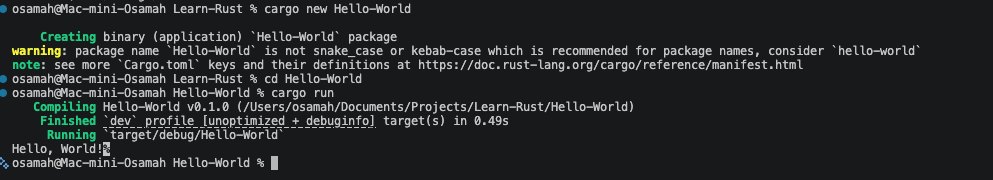

# My Rust Learning Journey

This repo documents my own journey of learning Rust.

## Resources

1. [The Rust Programming Language (The Book)](https://doc.rust-lang.org/book/)

# Day 1 : install rust 

use the command - curl --proto '=https' --tlsv1.2 -sSf https://sh.rustup.rs | sh -

to install rust 

## Next 

### run Hello World Program

Use the cargo to create the folder 

cargo new Hello-World

After create the folder and make the Hello World program 

we can test it with cargo run

That is it for Day 1